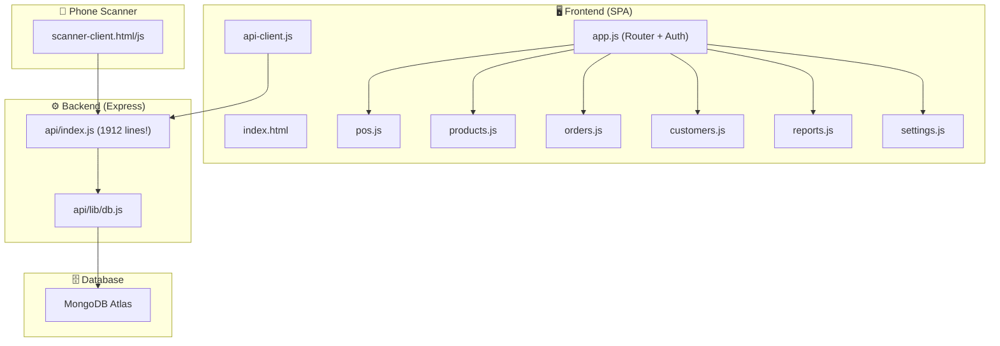
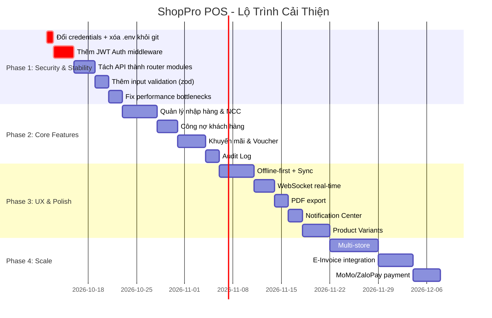

# 🛒 ShopPro POS — Phân Tích Source Code & Đề Xuất Cải Thiện

> Phân tích toàn diện ứng dụng quản lý bán hàng POS dựa trên Express + MongoDB + Electron/Web

---

## 📊 Tổng Quan Kiến Trúc Hiện Tại

| Thành phần | File | Kích thước |
|---|---|---|
| API Server (Express) | [`api/index.js`](file:///d:/Project/5.AI_app/10.BanHang/chumeo8duoi/api/index.js) | 1912 dòng (62KB) |
| App Core (Router, Auth, UI) | [`src/js/app.js`](file:///d:/Project/5.AI_app/10.BanHang/chumeo8duoi/src/js/app.js) | 1974 dòng (79KB) |
| POS Module | [`src/js/pos.js`](file:///d:/Project/5.AI_app/10.BanHang/chumeo8duoi/src/js/pos.js) | 57KB |
| Products Module | [`src/js/products.js`](file:///d:/Project/5.AI_app/10.BanHang/chumeo8duoi/src/js/products.js) | 43KB |
| Settings Module | [`src/js/settings.js`](file:///d:/Project/5.AI_app/10.BanHang/chumeo8duoi/src/js/settings.js) | 51KB |
| Reports Module | [`src/js/reports.js`](file:///d:/Project/5.AI_app/10.BanHang/chumeo8duoi/src/js/reports.js) | 45KB |
| CSS Styles | [`src/css/app.css`](file:///d:/Project/5.AI_app/10.BanHang/chumeo8duoi/src/css/app.css) | 68KB |
| DB Layer (MongoDB) | [`api/lib/db.js`](file:///d:/Project/5.AI_app/10.BanHang/chumeo8duoi/api/lib/db.js) | 188 dòng |
| Scanner Client (PWA) | [`src/scanner-client.js`](file:///d:/Project/5.AI_app/10.BanHang/chumeo8duoi/src/scanner-client.js) | 101KB |

---

## 🟢 PHẦN 1: CÁC VẤN ĐỀ NGHIÊM TRỌNG (ĐÃ TRIỂN KHAI HOÀN TẤT ✅)

### 1.1 🔐 Bảo Mật (Security) — **Trạng Thái: ĐÃ HOÀN TẤT**

| # | Vấn đề | File | Mức độ |
|---|---|---|---|
| S1 | **File `.env` bị commit lên Git** chứa full MongoDB URI với username/password | [`.env`](file:///d:/Project/5.AI_app/10.BanHang/chumeo8duoi/.env) | 🔴 Critical |
| S2 | `.gitignore` có `.env` nhưng **file `.env` vẫn tồn tại trong repo** — có thể đã bị commit từ trước | [`.gitignore`](file:///d:/Project/5.AI_app/10.BanHang/chumeo8duoi/.gitignore) | 🔴 Critical |
| S3 | **Không có authentication middleware** cho API — tất cả endpoint đều public, bất kỳ ai có URL đều xóa được data | [`api/index.js`](file:///d:/Project/5.AI_app/10.BanHang/chumeo8duoi/api/index.js) | 🔴 Critical |
| S4 | **CSP cho phép `'unsafe-inline'`** cho cả script và style — dễ bị XSS | [`index.html:6`](file:///d:/Project/5.AI_app/10.BanHang/chumeo8duoi/src/index.html#L6) | 🟡 High |
| S5 | **Rate limiter chỉ dùng in-memory Map** — reset khi server restart, không hoạt động trên Vercel serverless (mỗi request = cold start mới) | [`api/index.js:1360`](file:///d:/Project/5.AI_app/10.BanHang/chumeo8duoi/api/index.js#L1360) | 🟡 High |
| S6 | User credentials lưu plaintext trong `localStorage/sessionStorage` (JSON object user) | [`app.js:381-385`](file:///d:/Project/5.AI_app/10.BanHang/chumeo8duoi/src/js/app.js#L381-L385) | 🟡 Medium |
| S7 | **`DELETE /api/products/:id`** không có xác thực quyền — nhân viên có thể xóa sản phẩm | [`api/index.js:255`](file:///d:/Project/5.AI_app/10.BanHang/chumeo8duoi/api/index.js#L255) | 🟡 High |

> [!CAUTION]
> **Hành động ngay lập tức**: Đổi MongoDB URI credentials, xóa `.env` khỏi git history (`git filter-branch` hoặc `BFG Repo-Cleaner`), thêm API authentication middleware.

### 1.2 ⚡ Hiệu Năng (Performance) — **Mức Độ: HIGH**

| # | Vấn đề | Chi tiết |
|---|---|---|
| P1 | **`api/index.js` = 1912 dòng monolith** | Tất cả ~50+ endpoints trong 1 file duy nhất → khó maintain, khó debug |
| P2 | **ABC Analysis load TẤT CẢ orders + products vào RAM** | [`api/index.js:1229`](file:///d:/Project/5.AI_app/10.BanHang/chumeo8duoi/api/index.js#L1229) — khi có 10K+ đơn sẽ cực kỳ chậm/crash |
| P3 | **Profit Report load toàn bộ orders + products** | [`api/index.js:1146-1151`](file:///d:/Project/5.AI_app/10.BanHang/chumeo8duoi/api/index.js#L1146-L1151) — nên dùng MongoDB aggregation |
| P4 | **Hourly Report load toàn bộ orders rồi group trong JS** | [`api/index.js:1205`](file:///d:/Project/5.AI_app/10.BanHang/chumeo8duoi/api/index.js#L1205) — nên dùng `$group` + `$hour` aggregation |
| P5 | **Scanner polling interval 1.2s** | [`api-client.js:102`](file:///d:/Project/5.AI_app/10.BanHang/chumeo8duoi/src/js/api-client.js#L102) — Gây tải không cần thiết, nên dùng WebSocket/SSE |
| P6 | **Photo polling cứ 2s gọi API** | [`api-client.js:105`](file:///d:/Project/5.AI_app/10.BanHang/chumeo8duoi/src/js/api-client.js#L105) — Gây lãng phí bandwidth trên cloud |
| P7 | **`getProducts` luôn fetch ALL categories** để map tên | [`api/index.js:135`](file:///d:/Project/5.AI_app/10.BanHang/chumeo8duoi/api/index.js#L135) — nên cache hoặc dùng `$lookup` |
| P8 | **Batch save products chạy tuần tự** | [`api/index.js:273`](file:///d:/Project/5.AI_app/10.BanHang/chumeo8duoi/api/index.js#L273) — `for...of` + `await` từng sản phẩm, không dùng bulk operations |

### 1.3 🐛 Bugs & Logic Errors

| # | Bug | File | Chi tiết |
|---|---|---|---|
| B1 | **`escapeHtml` bị khai báo 2 lần** | [`app.js:6`](file:///d:/Project/5.AI_app/10.BanHang/chumeo8duoi/src/js/app.js#L6) và [`app.js:1033`](file:///d:/Project/5.AI_app/10.BanHang/chumeo8duoi/src/js/app.js#L1033) | Lần 2 ghi đè lần 1 — không gây lỗi nhưng là code smell |
| B2 | **`removeVietnameseTones` bị trùng** giữa frontend + backend | [`app.js:991`](file:///d:/Project/5.AI_app/10.BanHang/chumeo8duoi/src/js/app.js#L991) + [`api/index.js:46`](file:///d:/Project/5.AI_app/10.BanHang/chumeo8duoi/api/index.js#L46) | Code duplicate |
| B3 | **`scanner_events` collection grow unlimited** | Cleanup chỉ chạy khi có scan mới ([`api/index.js:1638`](file:///d:/Project/5.AI_app/10.BanHang/chumeo8duoi/api/index.js#L1638)) — nếu không ai scan, old events vẫn ở đó mãi mãi |
| B4 | **`scanner_photos` collection không bao giờ được cleanup** | [`api/index.js:1860`](file:///d:/Project/5.AI_app/10.BanHang/chumeo8duoi/api/index.js#L1860) — base64 images tích tụ vô hạn trong MongoDB |
| B5 | **`authenticateUser` client gọi theo kiểu cũ** `(userId, pin)` | [`app.js:601`](file:///d:/Project/5.AI_app/10.BanHang/chumeo8duoi/src/js/app.js#L601) — inconsistent với API interface |
| B6 | **Schema mismatch**: README nói `better-sqlite3`, nhưng code thực tế dùng **MongoDB** | [`README.md:61`](file:///d:/Project/5.AI_app/10.BanHang/chumeo8duoi/README.md#L61) vs [`api/lib/db.js`](file:///d:/Project/5.AI_app/10.BanHang/chumeo8duoi/api/lib/db.js) |
| B7 | **`database/schema.sql` và `database/db.js` bị orphaned** | Không còn được sử dụng (đã migrate sang MongoDB) nhưng vẫn tồn tại trong repo |

---

## 🟢 PHẦN 2: CÁC VẤN ĐỀ CẢI THIỆN KIẾN TRÚC & UX (ĐÃ TRIỂN KHAI HOÀN TẤT ✅)

### 2.1 🏗️ Kiến Trúc Code (Architecture)

| # | Vấn đề | Giải pháp đề xuất |
|---|---|---|
| A1 | **Monolithic API file** (1912 dòng) | Tách thành router modules: `routes/products.js`, `routes/orders.js`, `routes/auth.js`, v.v. |
| A2 | **Frontend là tập hợp global functions** | Chuyển sang ES Modules hoặc class-based architecture, tránh `window.xxx = xxx` |
| A3 | **Không có validation layer** | Thêm middleware validate (joi, zod) cho tất cả POST/PUT endpoints |
| A4 | **Không có error handling middleware** | Thêm Express error handler thay vì try/catch lặp lại 50+ lần |
| A5 | **HTML strings được build trong JS** | Chuyển sang template engine hoặc Web Components |
| A6 | **Services (`logger.js`, `plugin-manager.js`, `updater.js`) không được API sử dụng** | Chỉ dùng cho Electron — cần tích hợp hoặc loại bỏ dead code |

### 2.2 🧪 Testing

| # | Vấn đề | Hiện trạng |
|---|---|---|
| T1 | **Chỉ có 2 file test** | `db.test.js` + `d2_features.test.js` — coverage rất thấp |
| T2 | **Không có integration test cho API** | Không test được 50+ endpoints |
| T3 | **Không có E2E test** | Không có Playwright/Cypress |
| T4 | **Không có CI/CD pipeline** | Không có GitHub Actions, không chạy test tự động |

### 2.3 📱 UX/UI

| # | Vấn đề | Chi tiết |
|---|---|---|
| U1 | **Không có loading skeleton** | Trang trắng khi đang fetch data |
| U2 | **Không có offline support** | Service Worker (`sw.js`) tồn tại nhưng không cache API responses |
| U3 | **Không có pagination UI rõ ràng** | Products/Orders load tất cả — khi có 1000+ items sẽ rất chậm |
| U4 | **Toast notification trùng lặp** | Cùng lúc có thể hiển thị nhiều toast giống nhau |
| U5 | **Modal chỉ có 1 layer** | Không support modal chồng modal (ví dụ confirm trong modal edit) |
| U6 | **Không có breadcrumb** | Khó biết đang ở đâu trong nested views |
| U7 | **Responsive chưa tối ưu cho tablet** | Sidebar cần điều chỉnh cho màn hình 768-1024px |

---

## 🟢 PHẦN 3: FEATURES CẦN THÊM ĐỂ HOÀN HẢO

### 3.1 💰 Features Kinh Doanh (Business-Critical)

| # | Feature | Mô tả | Mức ưu tiên |
|---|---|---|---|
| F1 | **🧾 Hóa đơn điện tử (E-Invoice)** | Kết nối với nhà cung cấp hóa đơn điện tử (VNPT, Viettel, FPT) — bắt buộc theo luật VN | 🔴 Critical |
| F2 | **💳 Thanh toán MoMo / ZaloPay** | Tích hợp QR thanh toán qua ví điện tử — xu hướng thị trường | 🔴 High |
| F3 | **📦 Quản lý nhập hàng (Purchase Orders)** | Tạo phiếu nhập hàng, theo dõi nhà cung cấp, lịch sử nhập, giá vốn tự động cập nhật | 🔴 High |
| F4 | **🏷️ Quản lý khuyến mãi (Promotions)** | Mua X tặng Y, giảm giá %, voucher, coupon code, flash sale, combo deals | 🟡 High |
| F5 | **📊 Dashboard thời gian thực** | Auto-refresh doanh số realtime, biểu đồ live, so sánh hôm nay vs hôm qua | 🟡 Medium |
| F6 | **📱 Multi-store (Đa cửa hàng)** | Quản lý nhiều chi nhánh, chuyển kho liên chi nhánh | 🟡 Medium |
| F7 | **🗓️ Quản lý lịch hẹn & đặt hàng trước** | Pre-order, booking, deposit | 🟡 Medium |
| F8 | **💵 Quản lý công nợ (Debt Management)** | Theo dõi khách hàng nợ, nhắc thanh toán, lịch sử thanh toán từng phần | 🟡 High |

### 3.2 🛡️ Features Kỹ Thuật (Technical Features)

| # | Feature | Mô tả | Mức ưu tiên |
|---|---|---|---|
| T1 | **🔑 JWT Authentication cho API** | Token-based auth, refresh token, session management | 🔴 Critical |
| T2 | **📋 Audit Log (Nhật ký hoạt động)** | Ghi lại ai làm gì, lúc nào — bắt buộc cho hệ thống tài chính | 🔴 High |
| T3 | **💾 Backup & Restore thật sự** | Export/Import full database, scheduled backup, backup to Google Drive/S3 | 🟡 High |
| T4 | **🌐 WebSocket thay thế Polling** | Cho scanner events, real-time dashboard, notification push | 🟡 High |
| T5 | **📄 Xuất PDF hóa đơn/báo cáo** | PDF generation cho receipts, reports, profit statements | 🟡 Medium |
| T6 | **🔄 Offline-first + Sync** | IndexedDB local cache, tự đồng bộ khi có mạng — quan trọng cho POS | 🟡 High |
| T7 | **📊 Export Excel nâng cao** | Xuất báo cáo doanh thu, lợi nhuận, khách hàng ra Excel/CSV | 🟡 Medium |
| T8 | **🏷️ Multi-currency support** | Hỗ trợ nhiều loại tiền tệ (VND, USD, v.v.) | ⚪ Low |
| T9 | **🌍 Multi-language (i18n)** | Hỗ trợ đa ngôn ngữ (Việt, Anh, v.v.) | ⚪ Low |
| T10 | **📱 PWA cải tiến** | Installable, push notifications, offline transactions | 🟡 Medium |

### 3.3 👥 Features Người Dùng (User Experience)

| # | Feature | Mô tả | Mức ưu tiên |
|---|---|---|---|
| X1 | **🔔 Notification Center** | Chuông thông báo hàng sắp hết, đơn mới, khách VIP mua hàng | 🟡 Medium |
| X2 | **📋 Lịch sử thao tác (Undo/Redo)** | Hoàn tác thao tác vừa làm (xóa nhầm sản phẩm, sửa giá) | 🟡 Medium |
| X3 | **🖨️ Tùy chỉnh mẫu in** | Template editor cho hóa đơn, barcode labels, price tags | 🟡 High |
| X4 | **📷 Nhiều ảnh sản phẩm** | Gallery thay vì 1 ảnh duy nhất | 🟡 Medium |
| X5 | **🏷️ Biến thể sản phẩm** | Size/Color/Material variants — quan trọng cho shop thời trang | 🟡 High |
| X6 | **📊 Báo cáo so sánh** | So sánh doanh thu tuần này vs tuần trước, tháng này vs tháng trước | 🟡 Medium |
| X7 | **💬 Ghi chú nội bộ (Staff Notes)** | Nhân viên để lại ghi chú cho ca sau | ⚪ Low |
| X8 | **🔍 Lọc nâng cao & Saved Filters** | Lưu bộ lọc tùy chỉnh cho báo cáo | ⚪ Low |
| X9 | **📱 Responsive cho mobile staff** | Nhân viên xem đơn hàng, kiểm kho trên điện thoại | 🟡 Medium |

---

## 🛠️ PHẦN 4: ROADMAP TRIỂN KHAI ĐỀ XUẤT

---

## ✅ PHẦN 5: ĐIỂM MẠNH CỦA DỰ ÁN

Để công bằng, dự án có nhiều điểm rất tốt:

| ✅ | Điểm mạnh |
|---|---|
| 🎯 | **Dual-mode hoạt động xuất sắc**: Chạy được cả Electron desktop lẫn Web/Vercel — rất hiếm POS nào làm được |
| 🎨 | **UI/UX rất đẹp**: Dark/Light mode, custom theme color, responsive sidebar |
| 📱 | **Phone Scanner qua WiFi/Cloud**: Feature killer — quét barcode từ điện thoại, chụp ảnh sản phẩm |
| 🔒 | **PIN/Scrypt authentication**: Mã hóa PIN bằng scrypt — đúng best practice |
| 💼 | **Shift management hoàn chỉnh**: Mở ca, chốt ca, đối soát tiền mặt |
| 🤖 | **ABC Analysis**: Phân tích Pareto 80/20 — feature nâng cao cho POS |
| 🌐 | **Vietnamese search diacritics-insensitive**: Tìm kiếm không dấu — rất quan trọng |
| 🛡️ | **Brute force protection**: Rate limiting login attempts — nhiều POS bỏ qua |
| 🔌 | **Plugin architecture**: Hệ thống plugin extensible — forward-thinking |
| 💵 | **Cash flow tracking**: Sổ quỹ thu chi — nhiều POS thiếu feature này |

---

## 📌 TÓM TẮT ƯU TIÊN

> [!IMPORTANT]
> **Top 5 việc cần làm NGAY:**
> 1. 🔐 **Xóa credentials khỏi git, đổi MongoDB password**
> 2. 🔑 **Thêm JWT auth middleware cho API**
> 3. 🏗️ **Tách `api/index.js` thành modules**
> 4. ⚡ **Fix performance: dùng MongoDB aggregation thay vì load all**
> 5. 📋 **Thêm Audit Log cho hệ thống tài chính**

> **Top 5 features thêm mới:**
> 1. 📦 **Quản lý nhập hàng & Nhà cung cấp**
> 2. 🏷️ **Khuyến mãi, voucher, combo**
> 3. 💵 **Quản lý công nợ**
> 4. 🏷️ **Biến thể sản phẩm (size/color)**
> 5. 🌐 **Offline-first + Sync**
